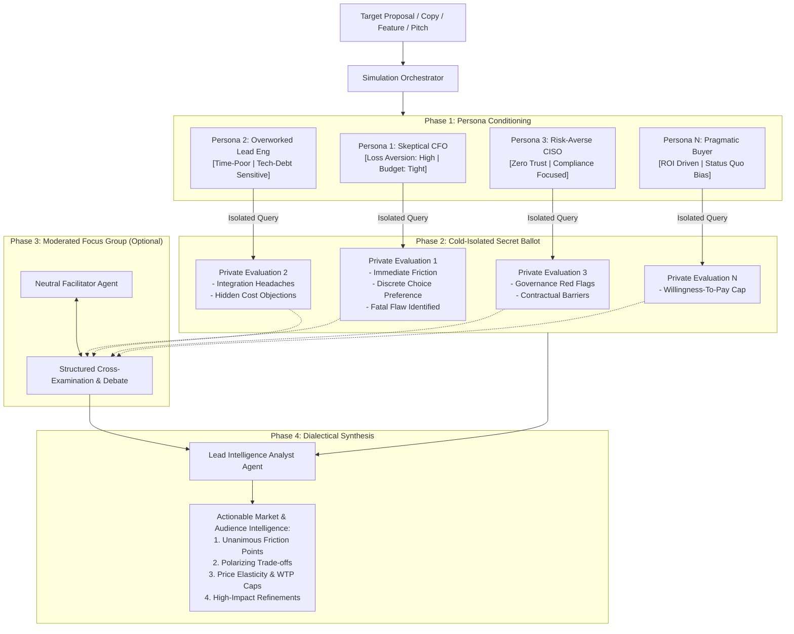

# Flagship Simulation Architecture: Target Audience & Human Persona Simulation

> The definitive engineering and theoretical blueprint for simulating human audiences, client personas, and decision-making committees using multi-agent ensembles.

---

## 1. Executive Philosophy & The Core Problem

When engineers, founders, marketers, and researchers test ideas, copy, pricing, or strategic decisions, they face a costly barrier: **real human feedback is slow, expensive, and subject to social desirability bias**. 

However, naively prompting a large language model with *"Imagine you are a customer, do you like this product?"* produces catastrophic failure:
* **The Sycophancy Trap**: RLHF aligns models to be polite, agreeable assistants. They enthusiastically approve almost any pitch.
* **The Stereotype Trap**: Shallow prompts (e.g., *"You are a 45-year-old CFO"*) cause the model to act out exaggerated, cartoonish tropes rather than authentic decision dynamics.
* **The Bandwagon Trap**: Putting multiple persona agents in a single shared chat leads to rapid cascade conformity, where the first agent's opinion anchors the rest.

The **Target Audience Simulator** replaces naive prompting with a mathematically grounded, 4-phase behavioral simulation pipeline:
1. **4D Vector Conditioning**: Grounding personas in empirical priors, concrete constraints, and loss functions.
2. **Cold-Isolated Secret Ballot**: Eliciting unvarnished, independent individual reactions with zero inter-agent cross-contamination.
3. **Discrete Choice & Trade-Off Enforcement**: Forcing explicit trade-offs and finite budget allocations under Random Utility Theory.
4. **Moderated Deliberation & Dialectical Synthesis**: Bringing conflicting agents into structured deliberation and extracting core failure modes and objections.

---

## 2. Theoretical Pillars & Foundations

### Pillar 1: Algorithmic Fidelity & Silicon Sampling
* **Origin**: Argyle et al. (2023), *Political Analysis*; Aher et al. (2022), Microsoft Research.
* **Core Principle**: Pretrained language models contain an internalized joint distribution over human beliefs, attitudes, language styles, and decision tendencies.
* **Algorithmic Fidelity**: The degree to which an LLM accurately reflects the conditional distribution $P(Response \mid Persona, Scenario)$ across varied human sub-populations. When conditioned properly on rich background contexts, the model does not just regurgitate average sentiments—it samples from the specific conditional sub-manifold of that demographic/psychographic profile.

### Pillar 2: Homo Silicus & Random Utility Modeling
* **Origin**: Horton, Filippas, & Manning (2023), NBER; Brand, Israeli, & Ngwe (2024), Harvard Business School / ACM EC.
* **Core Principle**: Simulated economic actors ("Homo Silicus") behave according to microeconomic choice theory when choices are framed as utility-maximizing decisions subject to constraints.
* **Discrete Choice Mathematics**: Based on Daniel McFadden's Random Utility Model (RUM):
  $$U_{ij} = V_{ij} + \epsilon_{ij}$$
  where $U_{ij}$ is the total utility persona $i$ derives from product option $j$, $V_{ij}$ is the deterministic value based on feature attributes (price, speed, ease), and $\epsilon_{ij}$ is an unobserved stochastic shock.
* **Implementation Rule**: Never ask an agent *"How much is this worth?"* Instead, present choice sets $\{A, B, C, \text{Status Quo}\}$ where each alternative has distinct feature and price trade-offs.

### Pillar 3: Cognitive Sycophancy Suppression
* **Origin**: Anthropic RLHF research (Perez et al., 2022); Sharma et al. (2023).
* **Core Principle**: Reinforcement Learning from Human Feedback (RLHF) creates a systemic bias toward agreeableness, flattery, and confirmation of user premises.
* **Mitigation Protocol**:
  * **Negative Framing Mandate**: Explicitly instruct persona agents that their professional competence depends on finding the hidden risks, unstated costs, and operational friction in the proposal.
  * **Zero Direct Pitching**: Present proposals neutrally as third-party artifacts (e.g., *"You received this unsolicited vendor proposal in your inbox this morning"* rather than *"What do you think of my idea?"*).
  * **Forced Alternative Comparison**: The agent must state what existing tool, process, or budget allocation they would have to cancel or demote to adopt the proposal.

### Pillar 4: Pre-Registration & Analytic Rigor
* **Origin**: Cummins (2025–2026), *Computational and Text Analysis Methods*.
* **Core Principle**: "Analytic Flexibility" occurs when researchers alter prompt formulations, persona descriptions, or temperature parameters repeatedly until the synthetic audience yields the desired positive validation.
* **Mitigation Protocol**:
  * Pre-define the evaluation metric (e.g., conversion threshold, objection hierarchy, net promoter score).
  * Lock the persona definitions in immutable YAML files prior to evaluating the proposal.
  * Execute multiple independent runs (temperature 0.7–0.9) to measure variance and construct confidence bounds.

---

## 3. The 4-Dimensional Persona State Vector

A robust persona is not a one-sentence role. It must be specified across four orthogonal dimensions:

### Dimension 1: Demographics & Contextual Environment
* Job Title, Seniority, and Reporting Line.
* Organization Profile: Headcount, ARR/Revenue, Industry, Growth Stage (e.g., boot-strapped vs venture-backed series B vs Fortune 500).
* Operating Environment: Legacy tech stack, regulatory jurisdiction (GDPR, HIPAA, SOC2), remote vs on-site.

### Dimension 2: Psychographics & Cognitive Biases
* Risk Appetite: Risk-seeking pioneer vs cautious pragmatist vs defensive bureaucrat.
* Cognitive Traps: High status-quo bias, sunk-cost attachment to current tools, loss aversion factor (e.g., losses hurt 2.5x more than gains).
* Reputation Drivers: What gets this persona promoted? What gets them fired?

### Dimension 3: Resource & Operational Constraints
* Discretionary Budget: Explicit purchasing authority limit without executive board approval.
* Time / Attention Bandwidth: High cognitive exhaustion vs exploratory bandwidth.
* Implementation Capacity: Existing backlog size and engineering bandwidth for onboarding new systems.

### Dimension 4: Behavioral Heuristics & Rejection Triggers
* Instant Turn-offs: Buzzwords (e.g., "AI-powered", "revolutionary", "disruptive", "frictionless"), lack of transparent pricing, mandatory sales calls.
* Proof Requirements: Peer references, live benchmark data, rollback safety guarantees.
* Default Inertia: The concrete reason why doing nothing is the safest choice today.

---

## 4. Execution Protocol: Step-by-Step

### Phase 1: Ingestion & Panel Configuration
* Load the target artifact (markdown proposal, sales copy, pricing sheet, or feature spec).
* Select or construct a representative panel of 3 to 10 heterogeneous personas spanning key decision influencers, budget holders, end-users, and compliance blockers.

### Phase 2: Cold-Isolated Secret Ballot
* For each persona agent in parallel:
  * Initialize an isolated context window with the 4D Persona Vector.
  * Inject the target artifact as an external stimulus.
  * Request structured JSON response:
    - Initial gut reaction (1–10 resonance score).
    - The Fatal Flaw: The single biggest reason to reject or abandon this immediately.
    - Confusion Matrix: Phrases or claims that felt ambiguous, misleading, or unsubstantiated.
    - Discrete Choice: Forced decision between [Adopt Now, Wait & Watch, Reject for Current Alternative].
    - Maximum Willingness-to-Pay ceiling (with specific budget trade-off justification).

### Phase 3: Moderated Cross-Examination (Focus Group)
* Bring 3 to 5 key personas into a shared multi-turn interaction facilitated by a neutral Moderator Agent.
* Moderator directs targeted friction inquiries:
  - *"Persona A (CFO) rejected this because of ROI ambiguity, while Persona B (Lead Dev) wants it for velocity. Persona B, how would you defend this purchase in an executive budget review?"*
* Record the debate to capture second-order social interactions, compromises, and unyielding stalemates.

### Phase 4: Synthesis & Strategic Prescriptions
* The Lead Intelligence Analyst Agent aggregates all isolated ballots and deliberation logs:
  - **Friction Heatmap**: Identifies universally flagged weak points.
  - **Objection Taxonomy**: Categorizes objections into Economic, Operational, Trust, and Clarity failures.
  - **Refinement Directives**: Prescriptive recommendations for revising the pitch or product design before real-world publication.
